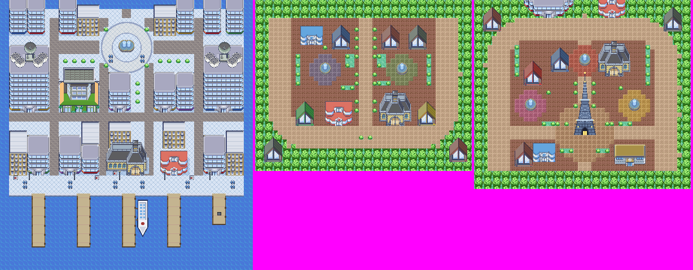
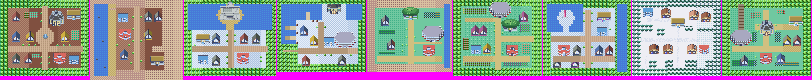
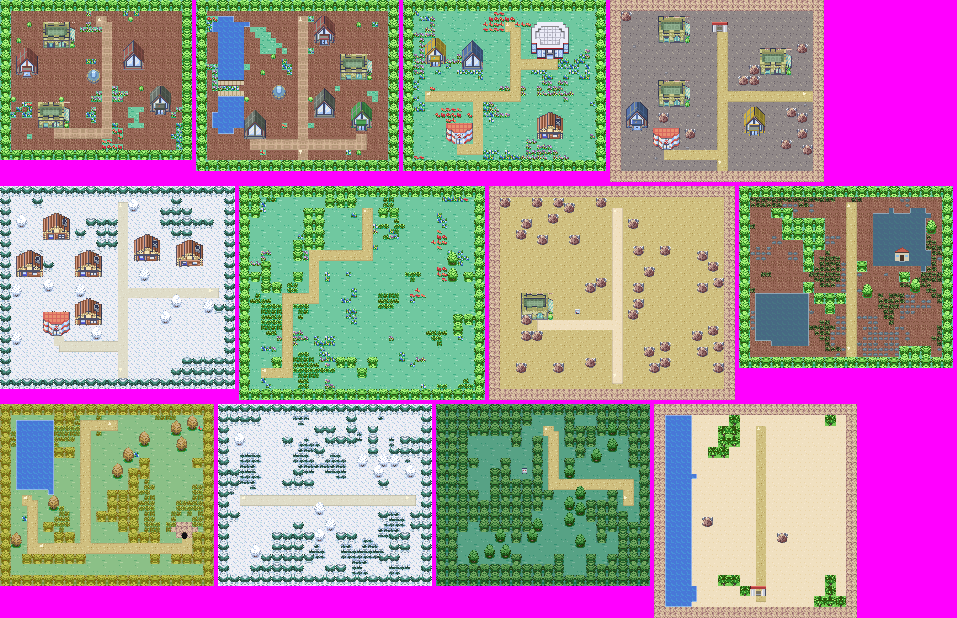
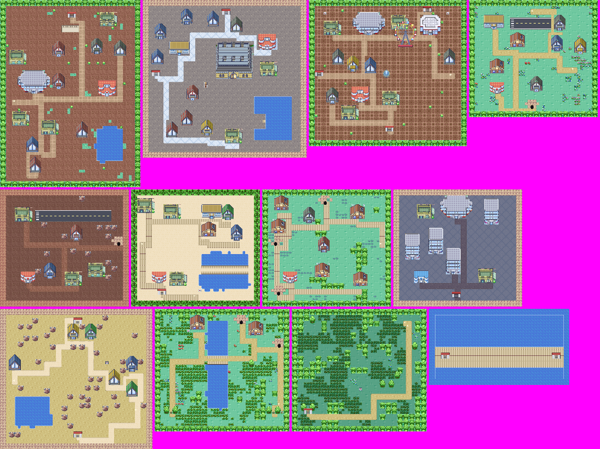
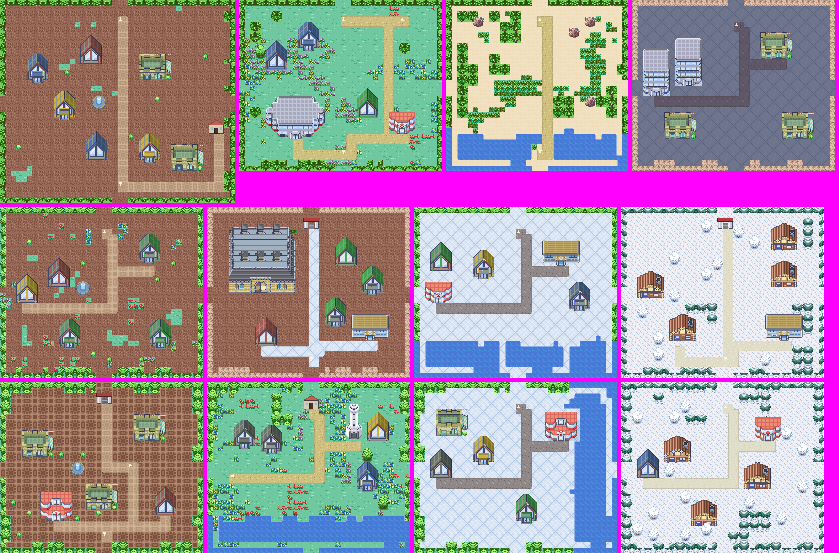
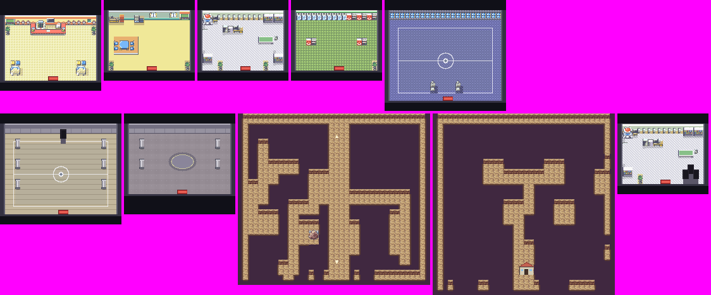
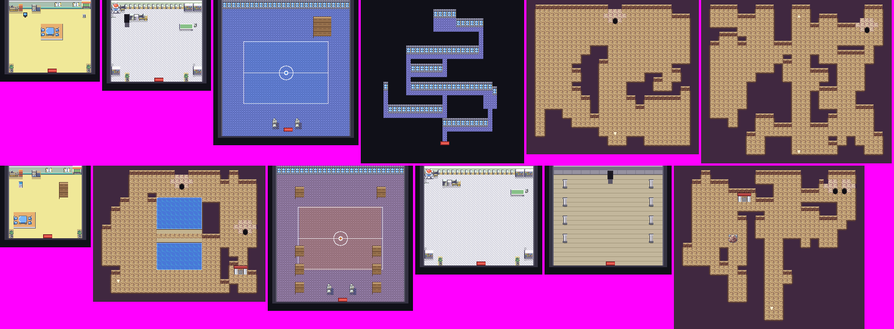
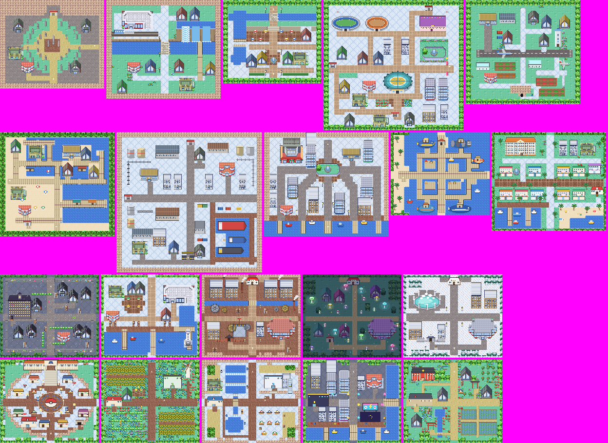
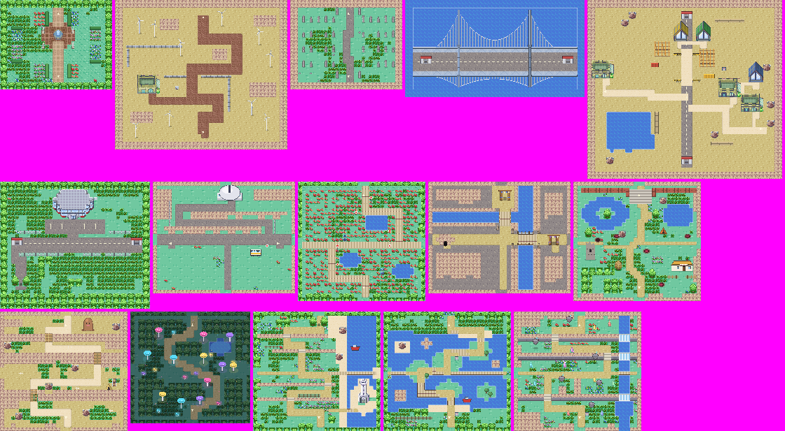
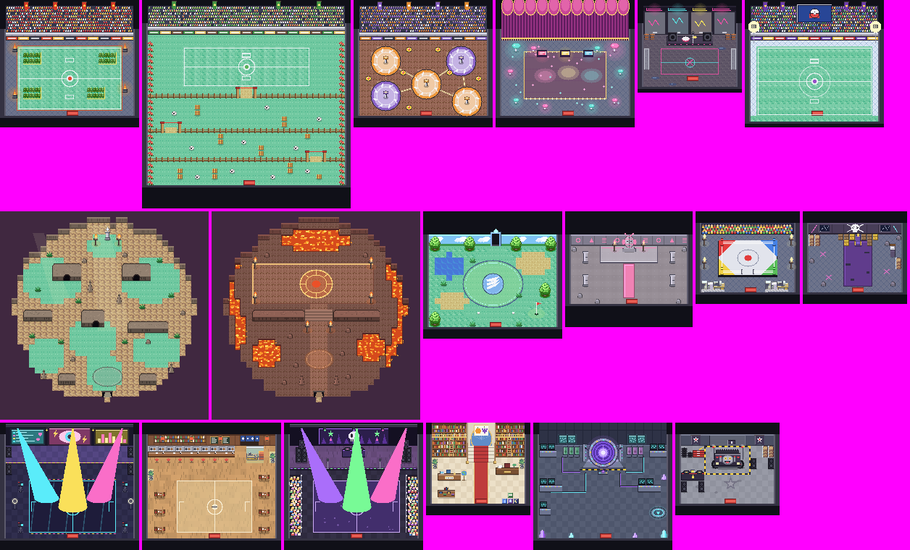

# City street plans: Castelia and the Kalos cities

Castelia City and the Kalos cities used to be the same generated template as
every other Unova and Kalos town: a paved field with a handful of identical
houses. They now have street plans of their own.



## What each map shows

| Map | Plan |
|---|---|
| `UnovaCasteliaCity` | Five piers on the southern seawall, the waterfront promenade, four streets running north between tower blocks, a back alley across them, and the round Central Plaza with its fountain below the Route 4 gate. The Pokémon Center is on the waterfront's east end by the Skyarrow Bridge gate. |
| `KalosLumioseSouth` | The lower arc of the ring boulevard, from the Route 5 gate round to the Route 4 gate, with Vernal Avenue up the middle, Sycamore's lab, the Pokémon Center, and Vert and Bleu Plazas. |
| `KalosLumioseNorth` | The upper arc, from Route 13 over Route 14 to Route 16, with Prism Tower on Centrico Plaza where the avenues meet, the station, museum, hotel and cafés, and Jaune, Rouge and Magenta Plazas. |

### The other Kalos cities



| Map | Plan |
|---|---|
| `KalosSantaluneCity` | Avenues crossing at the fountain plaza, the Gym to the north-east, flower beds. |
| `KalosCyllageCity` | Sea and beach to the west (still fishable), the town on its shelf, the Gym under the cliffs. |
| `KalosShalourCity` | The Tower of Mastery on an islet in the bay, reached over the sand. |
| `KalosCoumarineLower` | The harbour front with jetties and the Seaside Station. |
| `KalosCoumarineUpper` | The clifftop quarter: Hillcrest Station, and the Gym in its great tree. |
| `KalosLaverreCity` | Meadow paths through flower fields, the Gym in the old tree, the Poké Ball Factory to the north. |
| `KalosAnistarCity` | The town above the eastern sea with its crystal sundial. |
| `KalosSnowbelleCity` | Log cabins in the snow, ringed by frosted pines. |
| `KalosKiloudeCity` | The resort town around the Battle Maison, the station to the south. |

In seven of these nine every door, gate and person stands exactly where it did;
only Santalune's and Cyllage's doors moved. Alola's Hau'oli and Konikoni were
drawn over Santalune's and Laverre's old pictures, which are kept for them as
`KalosSantaluneCityClassic*` and `KalosLaverreCityClassic*`.

Kalos's towns and routes, and the rest of Unova, are covered by the themed
layouts described under [The rest of Kalos and Unova](#the-rest-of-kalos-and-unova).

The buildings, paving, water and fountains are cut from the Sinnoh city
pictures already in `assets/world/maps/` (`tools/lib/city-stamps.js`), so the
cities match Sinnoh's hand-drawn look. Prism Tower, the piers, seawall, ferry,
lamps, Anistar's sundial and the tree Gyms' crowns are drawn by the generator.

## Honest limits

- **Drawn from memory.** No reference site could be reached while this was
  built, so the plans follow the games' well-known shape, not a traced map.
  The order of Castelia's piers and streets, and which Lumiose plaza sits on
  which side, are best recollection and should be checked against a reference.
- **Castelia is a grid, not a fan.** The real streets curve in towards the
  plaza; here they run straight north and join it by a cross street.
- **The smaller Kalos cities are sketches of the real ones.** Each has its
  signature feature and the right kind of ground, but the street-by-street
  arrangement is simple and mostly keeps the old door positions.
- **Lumiose is still two maps.** They meet only along Vernal Avenue; the
  boulevard does not carry on from one map into the other.
- Interiors, the Castelia street rooms and `BW1CasteliaCity` (the Black/White
  campaign's copy) are unchanged.

## Compatibility

- Map names, sizes, warp indices, actor IDs and scripts are unchanged; doors
  and people moved. `tools/build-city-layouts.js` refuses to write a plan in
  which any warp or person is walled in or a door opens onto a wall.
- Stored landing points that aimed at a moved door (Fly, interior returns) are
  rewritten by the overlay. The Virbank ferry arrival, the Liberty Garden
  return, the Route 4 gate and both Lumiose Fly points did not move.
- A save left on a tile that is now a wall is moved to the nearest open tile by
  the regions' existing `recover` step; nothing else in the save changes.
- These maps opt out of the older decorative overlays (`ui/civic-map-art.js`,
  `ui/authored-region-art.js`, `ui/region-ambience.js`,
  `ui/region-terrain-detail.js`) through `cityLayout: true`.

## Regenerating

```sh
npm run build:city-layouts
node tests/city-layouts-test.js
```

The builder reads the committed base maps in `data/unova.js` and
`data/kalos.js` and writes `data/city-layouts.js`, which loads after every
region's data (so regions that copy a Kalos map as a template still copy the
old one). It needs no source checkout or network. Rebuilding Unova or Kalos from
source repaints these maps' pictures, so run it again afterwards.

To add a city: write a `city(name, ground)` block in the builder, place
buildings with `m.build(stamp, x, y, { warp })`, set gates with `m.warp`, and
call `finish` and `retarget`.

## The rest of Kalos and Unova




`tools/build-region-layouts.js` relays 339 outdoor maps. 181 are Kalos's seven
towns and all its routes, every Unova city, town and route other than Castelia,
and the Black/White campaign's copies (`BW1...`); these go in
`data/region-layouts.js`, which loads after `data/city-layouts.js`. The other
158 are every town and route of Alola, Galar and Paldea; see
[Alola, Galar and Paldea](#alola-galar-and-paldea).

These are **not** hand-drawn street plans. Each map is grown from its own
anchors:

- Every door, gate, person, sign, item and stored landing stays on the tile it
  had. Nothing in a save, script or Fly list needed to change.
- A building cut from the Sinnoh pictures is set on each door (Pokémon Center,
  Gym, shop, lab, station/hall, house), cave mouths and gatehouses are drawn on
  their warps, and towns get a few extra houses with no way in.
- Roads are routed between all the doors and gates; routes wind, town streets
  run straight.
- Tall grass is laid in patches, the same number of tiles as before. All the
  old water is kept (shores are roughened), so Surf and fishing spots have not
  moved, and land that water kept apart is still apart.
- Trees, groves, rocks and flower beds fill the rest, then anything that would
  cut off a person, gate or grass patch is cleared again.

Each place has a theme chosen from what the games show there (the `KALOS` and
`UNOVA` tables in the builder): forest for Santalune Forest, Pinwheel Forest and
the Winding Woods; marsh for Kalos Routes 14 and 19 and Icirrus; autumn for
Routes 15 and 16; snow for Dendemille, Frost Cavern and Route 17; desert for
Route 4, the Desert Resort and the Lumiose Badlands; ash for Lentimas; a dark
tower city for Black City; plank bridges for Skyarrow and the others; and so
on. A few have a landmark: Nimbasa's Ferris wheel, the Mistralton and Lentimas
runways, Anville's turntable, Floccesy's clock tower, Virbank's factory.

### Honest limits of the themed layouts

- **They are procedural, not the games' real maps.** The theme and the
  landmarks come from memory; where the road bends and where the trees stand is
  generated. Nobody should expect to recognise Route 7's actual shape.
- **Doors did not move**, so each town's buildings stand where the old
  template put them.
- Two doors had no room for a building and get a small porch instead (the
  Scary House on Kalos Route 14, which stands in water as it did before, and
  Striaton's restaurant).
- Water no longer animates on these maps (the old animation sheets are removed,
  as for the cities above).
- Caves, interiors, Gyms, the Castelia street rooms (`UnovaHouseCasteliaCity*`)
  and the underwater ruins are unchanged.
- Alola, Galar and Paldea maps that were drawn over a Kalos picture keep the old
  picture as `...Classic`, exactly as Hau'oli and Konikoni do.

### Alola, Galar and Paldea



These three regions used to draw every town and route as flat coloured blocks
at run time (`ui/alola-art.js`, `ui/galar-art.js`, `ui/paldea-art.js`) over a
borrowed Kalos picture. Their 158 outdoor maps now have pictures of their own,
made by the same builder with the same Sinnoh artwork.

- Their ground is laid out by `game/*-layouts.js` when the game starts, so the
  builder reads the maps after every game script has run and writes
  `game/region-layouts-late.js`, which is loaded last.
- Doors, gates, people and the open tiles on each map's rim are kept. Rooms
  entered by stepping onto a tile get a building over that tile where one fits.
- None of these maps had water. Seaside places (Hulbury, Cabo Poco, Levincia,
  the Alola beaches and so on) get a sea along one edge.
- The run-time block art no longer draws on these maps, nor on the regions'
  interiors (see [Rooms, Gyms and caves](#rooms-gyms-and-caves)).

**These are not at the level of Kanto, Johto and Hoenn, and cannot be made so
by this route.** Those three regions are the original games' own 2D maps. Kalos,
Alola, Galar and Paldea were 3D games with no 2D maps to take, so what is here
is a generated layout in a matching art style: right kind of place, right
buildings on the right doors, but not the real town plan.

## Rooms, Gyms and caves



The 130 interiors of Alola, Galar and Paldea were abstract tile patterns with
teal blocks for furniture. They are rebuilt by the same builder:

- **Rooms** (Pokémon Centers, shops, labs, houses) are a walled room sized to
  the map's exit and people, with a floor, wall and furniture cut from the Johto
  interiors already in the repo: the healing desk behind the nurse, PCs,
  bookshelves, plants and seats in a Center; fridges and shelves in a shop;
  machines and benches in a lab; kitchen, TV and table in a house.
- **Gyms and stadiums** are a lined court with a Poké Ball at its centre and
  statues by the door; League rooms and lobbies are pillared stone halls; small
  ruins and chambers are stone rooms with a dais under whoever waits there.
- **Caves and trial sites** are rock-walled caverns with winding passages, from
  the Oreburgh Gate cave artwork. Their wild encounters are kept.

Exits and people keep their tiles, and anything that blocks the way to one is
removed. That is the default for a room with no plan; every room now has a plan
of its own (see [Hand-planned routes and interiors](#hand-planned-routes-and-interiors)).
The open tiles the old rooms had on their rims are walled off.

### Kalos and Unova interiors and caves



The same builder now redraws the 561 interiors and caves of Kalos and Unova
(both campaigns), which were empty rooms and open rectangles of cave floor:

- **Rooms** keep their own shape. Their counters, PCs and the fixtures that
  can be examined (TVs, trash cans, vending machines) stay on their tiles and
  are drawn as such; the rest is floored, walled and furnished by kind (house,
  lab, shop, hall), and Gyms get a lined court.
- **Irregular rooms** (a Gym's puzzle paths, such as Santalune's web) are left
  exactly as they are and only redrawn.
- **Caves** become rock-walled caverns with winding passages. Their water,
  wild encounters, exits, people and items stay; no pocket of floor is left
  that nobody can reach. A cave whose separate areas only join through other
  floors (Reflection Cave 1F) keeps its walls and is only redrawn.
- **Left alone:** Pokémon Centers, which already looked the part; Reversal
  Mountain, whose lava differs by version; and the underwater ruins.

On top of that default, 371 of them have hand-written plans (`kalos-rooms.js`,
`kalos-caves.js`, `unova-rooms.js`, `unova-caves-a.js`, `unova-caves-b.js`,
`bw1-rooms.js`): every Gym room in both regions drawn as its own challenge
(Santalune's web, Shalour's rink, Laverre's dollhouse rooms, Anistar's
starfield; Virbank's club, Nimbasa's catwalk, Humilau's lily pads; the
Black/White Gyms), the League rooms, N's Castle, the Plasma Frigate, the story
buildings, and every cave and dungeon floor (Glittering Cave, Reflection Cave,
Frost Cavern, Terminus Cave; the Castelia Sewers, Relic Castle, Chargestone
Cave, Twist Mountain, Dragonspiral Tower, the Regi chambers, the Hidden
Grottoes). Ordinary houses, shops and gatehouses keep the default.

A room plan in these two regions can only redraw: it re-tiles the floor and
paints the set-piece, and never changes where you can walk, so a Gym's puzzle
paths are exactly the game's. Where this game's Gym was an empty hall (most of
Unova's), the challenge is scenery, and some plans stand props on the open
floor. Belts, ice, quicksand, rails and catwalks are drawn, not mechanics.
In the planned caves the wild encounters are on the drawn floor, unseen.
Paths are checked without walking through people, on every map.

## Hand-planned towns



Every town and city in Kalos, Unova (both campaigns), Alola, Galar and Paldea
that did not already have a street plan above now has a plan of its own in
`tools/plans/` (`kalos.js`, `unova.js`, `bw1.js`, `alola.js`, `galar.js`,
`paldea.js`): 120 maps. A plan is written by hand for one town. It lays down
that town's streets, water, squares and cliffs, says which building stands on
each door, places the extra buildings, and draws the town's landmarks in code
(Geosenge's standing stones, Couriway's waterfalls, Nimbasa's stadiums and
Ferris wheel, Mistralton's runway, Seafolk Village's houseboats, Motostoke's
canal and gears, Ballonlea's glowing mushrooms, Mesagoza's plaza and stairway,
Artazon's sunflowers and windmill, and so on). The builder then finishes the
map as before and checks that every door, gate and person can still be reached.
`tools/plans/README.md` describes the plan calls; `tools/plan-preview.js`
shows a map's fixed points and its built picture.

What a plan cannot change:

- **Doors, gates and people stay on their tiles.** In Alola, Galar and Paldea
  nearly every town shares one template of fixed points (a north exit, a west
  door, a door at 27,10, and so on), and the Black/White towns share another.
  The towns are arranged around those, so compass directions often differ from
  the games (Driftveil's drawbridge is in the south, Po Town's Shady House in
  the west) and many towns have the same cross of main streets underneath.
- **They are drawn from memory**, not traced from the games. Several are
  impressions rather than street plans, and a few are not real places at all
  (Alola's postgame port, Paldea's League Club as an ocean platform).
- Buildings on a north-edge or west-edge entrance have little room, so some
  Centers and stations there are small hand-drawn fronts.
- The five Team Star bases share one camp layout with different colours and
  props.
- Routes, and the wild areas between towns, are still the generated layouts
  described above.
- The older landmark sprites (`ui/authored-region-art.js`) are no longer drawn
  on planned towns.

## Hand-planned routes and interiors




The plans in `tools/plans/` now cover every map the builder makes (469):

- **Routes and wild areas** of Kalos, Unova (both campaigns), Alola, Galar and
  Paldea (`*-routes.js`): each route's path, water, cliffs, woods and its own
  features — Kalos Route 10's menhir rows and Route 13's turbines, Unova's
  great bridges and the Route 9 motorway, Mount Hokulani's switchback road,
  Galar's Wild Area lakes and viaduct, Paldea's Titan sites and Area Zero.
- **Interiors of Alola, Galar and Paldea** (`*-rooms.js`): every Gym with its
  own challenge (Turffield's Wooloo fields, Stow-on-Side's spinning cups,
  Iono's streaming stage, Larry's eatery), Alola's trial sites and Elite Four
  rooms, the ruins, the Academy, the Team Star garages, homes, labs, and a
  regional Pokémon Center design for each region.

The same limits apply as for the towns: fixed points do not move, so real
geography is bent to fit them; the plans are from memory; cliffs are walls with
step gaps, not one-way ledges; weather is not drawn. Tall grass is still placed
by the builder on whatever plain ground a plan leaves, and where a plan draws
over all of it (Alola's Altar, Ultra Space) the wild encounters stay on the
drawn floor, unseen. Kalos's and Unova's own interiors and caves are not part
of this and are unchanged.

### Regenerating

```sh
npm run build:region-layouts
node tests/region-layouts-test.js
node tests/browser/region-layouts.js
```

Run it after `build:city-layouts`. `node tools/build-region-layouts.js Route5 --dry`
lays out only the maps whose name matches, without writing anything.
