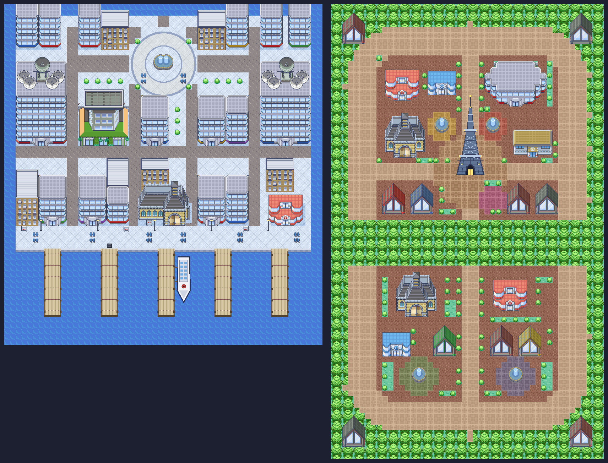

# City street plans: Castelia and Lumiose

Castelia City and both halves of Lumiose City used to be the same generated
template as every other Unova and Kalos town: a paved field with a handful of
identical houses. They now have street plans of their own.



## What each map shows

| Map | Plan |
|---|---|
| `UnovaCasteliaCity` | Five piers on the southern seawall, the waterfront promenade, four streets running north between tower blocks, a back alley across them, and the round Central Plaza with its fountain below the Route 4 gate. The Pokémon Center is on the waterfront's east end by the Skyarrow Bridge gate. |
| `KalosLumioseSouth` | The lower arc of the ring boulevard, from the Route 5 gate round to the Route 4 gate, with Vernal Avenue up the middle, Sycamore's lab, the Pokémon Center, and Vert and Bleu Plazas. |
| `KalosLumioseNorth` | The upper arc, from Route 13 over Route 14 to Route 16, with Prism Tower on Centrico Plaza where the avenues meet, the station, museum, hotel and cafés, and Jaune, Rouge and Magenta Plazas. |

The buildings, paving, water and fountains are cut from the Sinnoh city
pictures already in `assets/world/maps/` (`tools/lib/city-stamps.js`), so the
cities match Sinnoh's hand-drawn look. Prism Tower, the piers, seawall, ferry
and lamps are drawn by the generator.

## Honest limits

- **Drawn from memory.** No reference site could be reached while this was
  built, so the plans follow the games' well-known shape, not a traced map.
  The order of Castelia's piers and streets, and which Lumiose plaza sits on
  which side, are best recollection and should be checked against a reference.
- **Castelia is a grid, not a fan.** The real streets curve in towards the
  plaza; here they run straight north and join it by a cross street.
- **Lumiose is still two maps.** They meet only along Vernal Avenue; the
  boulevard does not carry on from one map into the other.
- Interiors, the Castelia street rooms and `BW1CasteliaCity` (the Black/White
  campaign's copy) are unchanged.

## Compatibility

- Map names, sizes, warp indices, actor IDs and scripts are unchanged; doors
  and people moved. `tools/build-city-layouts.js` refuses to write a plan in
  which any warp or person is walled in or a door opens onto a wall.
- Stored landing points that aimed at a moved door (Fly, interior returns) are
  rewritten by the overlay. The Virbank ferry arrival, the Liberty Garden
  return, the Route 4 gate and both Lumiose Fly points did not move.
- A save left on a tile that is now a wall is moved to the nearest open tile by
  the regions' existing `recover` step; nothing else in the save changes.
- These maps opt out of the older decorative overlays (`ui/civic-map-art.js`,
  `ui/authored-region-art.js`, `ui/region-ambience.js`,
  `ui/region-terrain-detail.js`) through `cityLayout: true`.

## Regenerating

```sh
npm run build:city-layouts
node tests/city-layouts-test.js
```

The builder reads the committed base maps in `data/unova.js` and
`data/kalos.js` and writes `data/city-layouts.js`, which loads straight after
them. It needs no source checkout or network. Rebuilding Unova or Kalos from
source repaints these maps' pictures, so run it again afterwards.

To add a city: write a `city(name, ground)` block in the builder, place
buildings with `m.build(stamp, x, y, { warp })`, set gates with `m.warp`, and
call `finish` and `retarget`.
