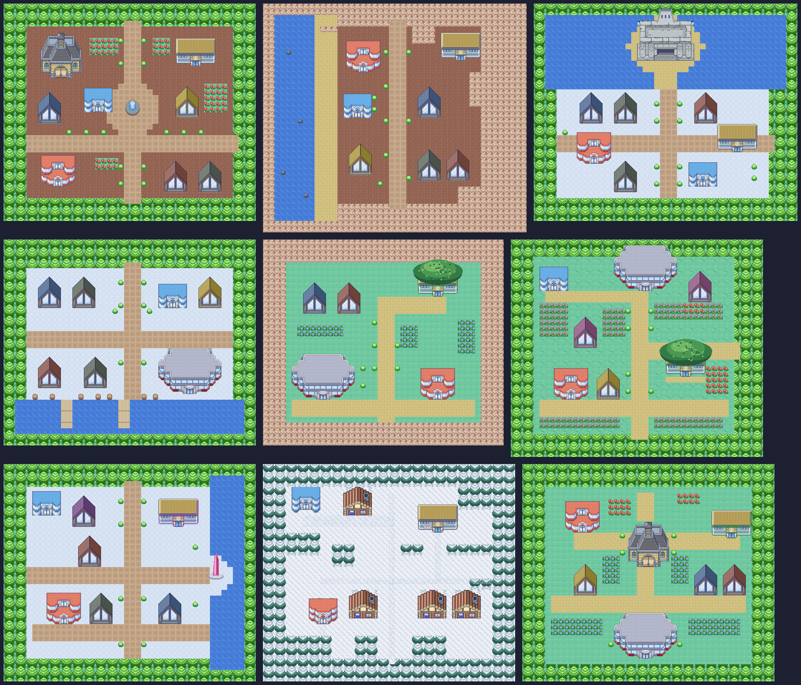
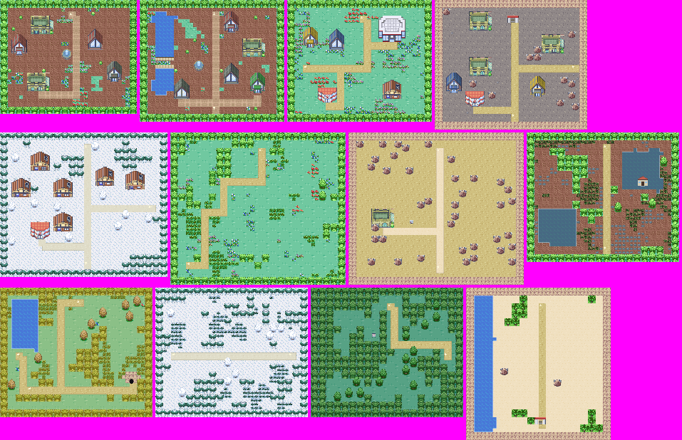
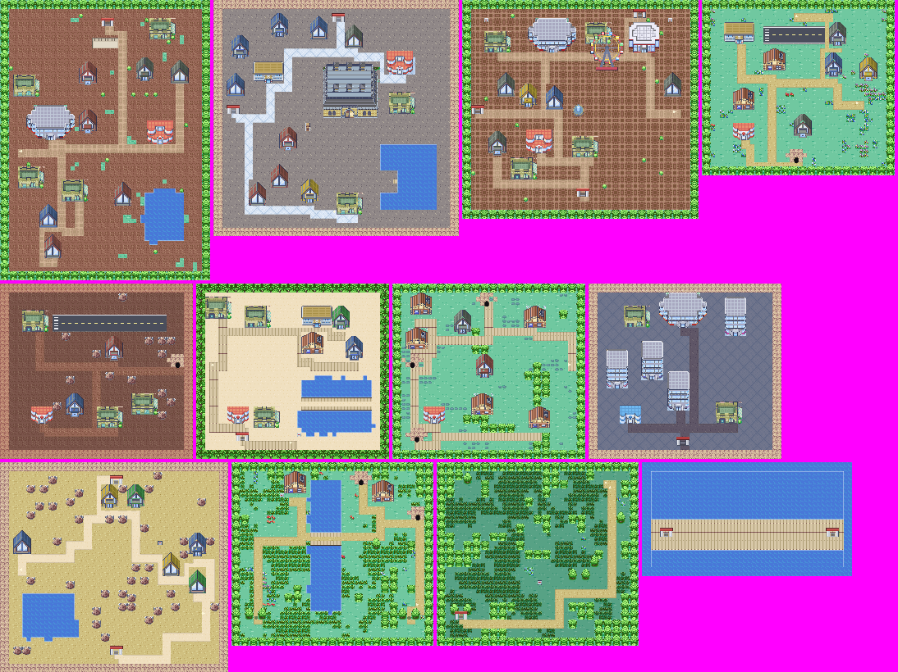

# City street plans: Castelia and the Kalos cities

Castelia City and the Kalos cities used to be the same generated template as
every other Unova and Kalos town: a paved field with a handful of identical
houses. They now have street plans of their own.


## What each map shows

| Map | Plan |
|---|---|
| `UnovaCasteliaCity` | Five piers on the southern seawall, the waterfront promenade, four streets running north between tower blocks, a back alley across them, and the round Central Plaza with its fountain below the Route 4 gate. The Pokémon Center is on the waterfront's east end by the Skyarrow Bridge gate. |
| `KalosLumioseSouth` | The lower arc of the ring boulevard, from the Route 5 gate round to the Route 4 gate, with Vernal Avenue up the middle, Sycamore's lab, the Pokémon Center, and Vert and Bleu Plazas. |
| `KalosLumioseNorth` | The upper arc, from Route 13 over Route 14 to Route 16, with Prism Tower on Centrico Plaza where the avenues meet, the station, museum, hotel and cafés, and Jaune, Rouge and Magenta Plazas. |

### The other Kalos cities



| Map | Plan |
|---|---|
| `KalosSantaluneCity` | Avenues crossing at the fountain plaza, the Gym to the north-east, flower beds. |
| `KalosCyllageCity` | Sea and beach to the west (still fishable), the town on its shelf, the Gym under the cliffs. |
| `KalosShalourCity` | The Tower of Mastery on an islet in the bay, reached over the sand. |
| `KalosCoumarineLower` | The harbour front with jetties and the Seaside Station. |
| `KalosCoumarineUpper` | The clifftop quarter: Hillcrest Station, and the Gym in its great tree. |
| `KalosLaverreCity` | Meadow paths through flower fields, the Gym in the old tree, the Poké Ball Factory to the north. |
| `KalosAnistarCity` | The town above the eastern sea with its crystal sundial. |
| `KalosSnowbelleCity` | Log cabins in the snow, ringed by frosted pines. |
| `KalosKiloudeCity` | The resort town around the Battle Maison, the station to the south. |

In seven of these nine every door, gate and person stands exactly where it did;
only Santalune's and Cyllage's doors moved. Alola's Hau'oli and Konikoni were
drawn over Santalune's and Laverre's old pictures, which are kept for them as
`KalosSantaluneCityClassic*` and `KalosLaverreCityClassic*`.

Kalos's towns and routes, and the rest of Unova, are covered by the themed
layouts described under [The rest of Kalos and Unova](#the-rest-of-kalos-and-unova).

The buildings, paving, water and fountains are cut from the Sinnoh city
pictures already in `assets/world/maps/` (`tools/lib/city-stamps.js`), so the
cities match Sinnoh's hand-drawn look. Prism Tower, the piers, seawall, ferry,
lamps, Anistar's sundial and the tree Gyms' crowns are drawn by the generator.

## Honest limits

- **Drawn from memory.** No reference site could be reached while this was
  built, so the plans follow the games' well-known shape, not a traced map.
  The order of Castelia's piers and streets, and which Lumiose plaza sits on
  which side, are best recollection and should be checked against a reference.
- **Castelia is a grid, not a fan.** The real streets curve in towards the
  plaza; here they run straight north and join it by a cross street.
- **The smaller Kalos cities are sketches of the real ones.** Each has its
  signature feature and the right kind of ground, but the street-by-street
  arrangement is simple and mostly keeps the old door positions.
- **Lumiose is still two maps.** They meet only along Vernal Avenue; the
  boulevard does not carry on from one map into the other.
- Interiors, the Castelia street rooms and `BW1CasteliaCity` (the Black/White
  campaign's copy) are unchanged.

## Compatibility

- Map names, sizes, warp indices, actor IDs and scripts are unchanged; doors
  and people moved. `tools/build-city-layouts.js` refuses to write a plan in
  which any warp or person is walled in or a door opens onto a wall.
- Stored landing points that aimed at a moved door (Fly, interior returns) are
  rewritten by the overlay. The Virbank ferry arrival, the Liberty Garden
  return, the Route 4 gate and both Lumiose Fly points did not move.
- A save left on a tile that is now a wall is moved to the nearest open tile by
  the regions' existing `recover` step; nothing else in the save changes.
- These maps opt out of the older decorative overlays (`ui/civic-map-art.js`,
  `ui/authored-region-art.js`, `ui/region-ambience.js`,
  `ui/region-terrain-detail.js`) through `cityLayout: true`.

## Regenerating

```sh
npm run build:city-layouts
node tests/city-layouts-test.js
```

The builder reads the committed base maps in `data/unova.js` and
`data/kalos.js` and writes `data/city-layouts.js`, which loads after every
region's data (so regions that copy a Kalos map as a template still copy the
old one). It needs no source checkout or network. Rebuilding Unova or Kalos from
source repaints these maps' pictures, so run it again afterwards.

To add a city: write a `city(name, ground)` block in the builder, place
buildings with `m.build(stamp, x, y, { warp })`, set gates with `m.warp`, and
call `finish` and `retarget`.

## The rest of Kalos and Unova




`tools/build-region-layouts.js` relays the other 181 outdoor maps: Kalos's seven
towns and all its routes, every Unova city, town and route other than Castelia,
and the Black/White campaign's copies (`BW1...`). It writes
`data/region-layouts.js`, which loads after `data/city-layouts.js`.

These are **not** hand-drawn street plans. Each map is grown from its own
anchors:

- Every door, gate, person, sign, item and stored landing stays on the tile it
  had. Nothing in a save, script or Fly list needed to change.
- A building cut from the Sinnoh pictures is set on each door (Pokémon Center,
  Gym, shop, lab, station/hall, house), cave mouths and gatehouses are drawn on
  their warps, and towns get a few extra houses with no way in.
- Roads are routed between all the doors and gates; routes wind, town streets
  run straight.
- Tall grass is laid in patches, the same number of tiles as before. All the
  old water is kept (shores are roughened), so Surf and fishing spots have not
  moved, and land that water kept apart is still apart.
- Trees, groves, rocks and flower beds fill the rest, then anything that would
  cut off a person, gate or grass patch is cleared again.

Each place has a theme chosen from what the games show there (the `KALOS` and
`UNOVA` tables in the builder): forest for Santalune Forest, Pinwheel Forest and
the Winding Woods; marsh for Kalos Routes 14 and 19 and Icirrus; autumn for
Routes 15 and 16; snow for Dendemille, Frost Cavern and Route 17; desert for
Route 4, the Desert Resort and the Lumiose Badlands; ash for Lentimas; a dark
tower city for Black City; plank bridges for Skyarrow and the others; and so
on. A few have a landmark: Nimbasa's Ferris wheel, the Mistralton and Lentimas
runways, Anville's turntable, Floccesy's clock tower, Virbank's factory.

### Honest limits of the themed layouts

- **They are procedural, not the games' real maps.** The theme and the
  landmarks come from memory; where the road bends and where the trees stand is
  generated. Nobody should expect to recognise Route 7's actual shape.
- **Doors did not move**, so each town's buildings stand where the old
  template put them.
- Two doors had no room for a building and get a small porch instead (the
  Scary House on Kalos Route 14, which stands in water as it did before, and
  Striaton's restaurant).
- Water no longer animates on these maps (the old animation sheets are removed,
  as for the cities above).
- Caves, interiors, Gyms, the Castelia street rooms (`UnovaHouseCasteliaCity*`)
  and the underwater ruins are unchanged.
- Alola, Galar and Paldea maps that were drawn over a Kalos picture keep the old
  picture as `...Classic`, exactly as Hau'oli and Konikoni do.

### Regenerating

```sh
npm run build:region-layouts
node tests/region-layouts-test.js
node tests/browser/region-layouts.js
```

Run it after `build:city-layouts`. `node tools/build-region-layouts.js Route5 --dry`
lays out only the maps whose name matches, without writing anything.
