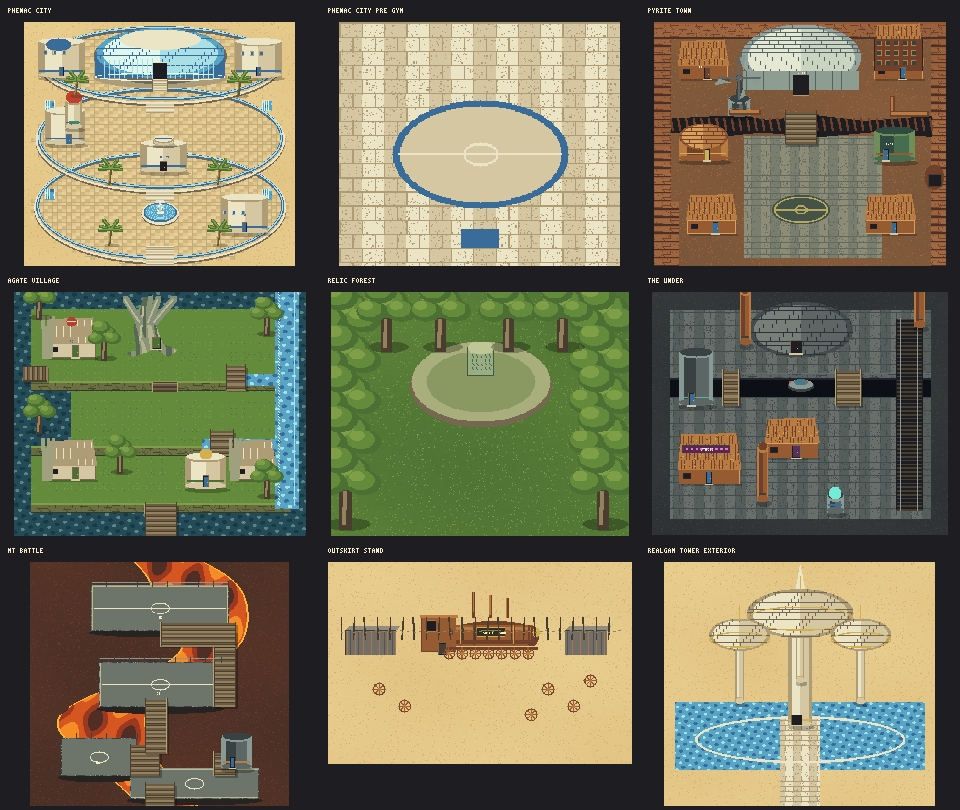

# Orre: Colosseum map projections

The exterior rebuild uses Colosseum's location models and screenshots as layout
references. The maps use north-up, 16-pixel tiles and condensed distances for the
existing game screen. Camera perspective and the height of buildings are flattened
into walkable floors, solid footprints and foreground artwork.



## Locations and references

| Place | Structures recreated | Reference |
|---|---|---|
| Phenac City | Circular water-bordered terraces, northern waterfall Stadium, central Pre Gym, lower fountain plaza, cylindrical services and north-west Mayor's house | [Location](https://bulbapedia.bulbagarden.net/wiki/Phenac_City), [model](https://archives.bulbagarden.net/media/upload/2/2a/Phenac_City.png) |
| Pyrite Town | Lower Duel Square, industrial buildings, the chasm and bridge, windmill on its south-west lip, northern white plated Colosseum | [Location](https://bulbapedia.bulbagarden.net/wiki/Pyrite_Town), [Colosseum model](https://archives.bulbagarden.net/media/upload/e/ef/Pyrite_Town_Colo.png) |
| Agate Village | Root-framed stone houses on grassy ledges, north-central hollow tree house, western forest path, bridges and eastern cascade | [Location](https://bulbapedia.bulbagarden.net/wiki/Agate_Village), [model](https://archives.bulbagarden.net/media/upload/8/8e/Agate_Village.png) |
| The Under | Northern Colosseum dome, dividing chasm, suspended disk, lower industrial settlement, western studio and eastern rail platform | [Location](https://bulbapedia.bulbagarden.net/wiki/The_Under), [Colosseum model](https://archives.bulbagarden.net/media/upload/b/bf/The_Under_Colo.png) |
| Mt. Battle | Volcanic caldera, lava flow, separate metal battle landings and connecting gantries | [Location](https://bulbapedia.bulbagarden.net/wiki/Mt._Battle), [mountain](https://archives.bulbagarden.net/media/upload/6/60/Mt_Battle.png) |
| Outskirt Stand | Locomotive diner, chimney cluster, shipping containers, scrap fence and discarded wheels in open desert | [Location](https://bulbapedia.bulbagarden.net/wiki/Outskirt_Stand), [model](https://archives.bulbagarden.net/media/upload/0/07/Outskirt_Stand.png) |
| Realgam Tower | Central spire and suspended satellite domes, with an exterior approach to the existing lobby | [Location](https://bulbapedia.bulbagarden.net/wiki/Realgam_Tower), [tower](https://archives.bulbagarden.net/media/upload/d/da/Realgam_Tower.png) |

Phenac and Agate's reference renders show the shared locations also used in XD.
Pyrite and The Under use explicitly Colosseum-labelled renders. The image sources
are references; the committed artwork is rendered by the project's own generator.

## Gameplay integration

- Existing exterior map sizes, story flags and actor IDs are retained. Services
  whose positions changed keep their reciprocal warp indices.
- Phenac's missing Pre Gym now has an entrance and a small training-room map.
  Justy's full battle sequence is not implemented by this map update.
- Eagun's house is in the northern tree. The Skrub encounter and purification
  interaction now take place at the Relic in the forest rather than in the village.
- Realgam's world-map unlock key remains `RealgamTower_1F`; its arrival is on
  `RealgamTower_Exterior`. Entering the lobby starts its existing story scene.
- Mt. Battle retains the three story landings and its existing 100-Trainer menu
  challenge. This projection does not add 100 individually explorable platforms.
- Old saves on a newly solid tile move to the nearest safe floor tile when
  exploration starts; party and story data are preserved.

The existing diner, Pokémon Center interiors, Mayor's house, Duking's house,
Pyrite Building, Shadow Lab, and Realgam's upper rooms retain their previous
interior maps. The custom Air Strip and existing Snagem Hideout are unchanged.
Full original interior floor plans remain future work.

## Regeneration and verification

```sh
npm run build:orre-layouts
npm test
PLAYWRIGHT_PATH=/path/to/playwright CHROMIUM=/path/to/chromium node tests/browser/orre-maps.js
```

`tools/build-orre-layouts.js` reads the committed base `data/orre-maps.js` and
writes `data/orre-layouts.js`, map layers, borders and this preview. It requires
no external source checkout or network access. The full `tools/build-orre.js`
builder runs this projection after regenerating its base maps.

The overlay loads after Orre's base maps and before Platinum's overlay. Sinnoh's
maps are preserved. Tests check all rebuilt NPC approaches and doors across five
story states, reciprocal travel, save relocation, bridges, gantries and the
relocated Relic encounter.
